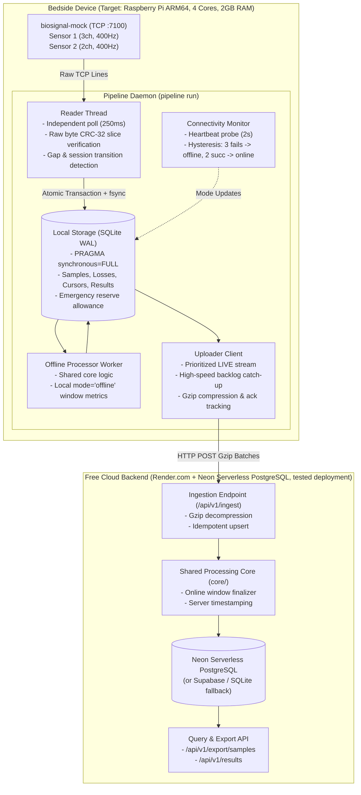

# Architecture & System Design: Never Lose a Heartbeat

## 1. High-Level Architecture

The MayaCardio bedside pipeline guarantees durable local preservation and real-time cloud analysis for continuous biosignals generated by the bedside device (`biosignal-mock`).

> **Execution Platform Note**: The pipeline was developed and empirically verified on **Windows 10/11 x86_64 (Python 3.12.3)** against Render.com free tier and Neon PostgreSQL. The designated target board in production is **Raspberry Pi OS (ARM64)** (untested on physical board).

---

## 2. Core Subsystems

### 2.1 Reader Subsystem
- **Independent High-Frequency Polling**: Polls Sensor 1 and Sensor 2 independently every 250 ms over persistent TCP.
- **Raw-Byte CRC-32 Verification**: Computes `zlib.crc32` directly over the raw bytes of the received JSON line sliced between the opening `[` and matching `]` of `"data":`. Never re-serializes parsed JSON.
- **Loss Accounting**: If the mock reports `lost` (e.g., `buffer_overflow`), records are saved directly. Gaps between expected and received indexes are captured as `gap_detected_unread`. On mock restarts, unread ranges from the old session are preserved with `to_index: null`.
- **Zero Cloud Coupling**: The reader never makes network calls to the cloud and cannot be blocked by cloud latency or network disconnects.

### 2.2 Durable Local Storage
- **Storage Engine**: SQLite in Write-Ahead Logging (WAL) mode with `PRAGMA synchronous = FULL`. Every reply batch (samples + loss records + cursor) is committed in a single atomic transaction with a filesystem sync.
- **Conflicting Duplicate Rejection**: Duplicate primary keys `(session_id, sensor, idx)` with matching values are ignored (idempotent); conflicting values are rejected and logged with `[ERROR]`.
- **Disk Full (ENOSPC) Allowance**: A 512 KB emergency reserve file (`.emergency_reserve`) is maintained on disk. When `sqlite3.OperationalError: database or disk is full` is encountered, the reserve file is released, allowing emergency loss records (`reason: 'disk_full'`) to be committed without crashing silently `[MEASURED via test_disk_full.py]`.
- **Session-Scoped Status Calculation**: Status metrics calculate exact physical row counts `WHERE session_id = ? AND sensor = ? AND idx <= last_acked_idx`, ensuring `samples_in_cloud <= samples_saved` and `backlog == samples_saved - samples_in_cloud` regardless of initial loss ranges or non-zero start indices.

### 2.3 Shared Core Processing ([`core/`](core/))
- **Single Shared Module**: Exactly identical code is executed by the device (for offline processing) and the cloud service (for online streaming ingestion).
- **Peak Detection**: Stateful across the entire session stream using a monotonic maximum tracker over the preceding 800 samples ($O(1)$ amortized time).
- **Lookahead Finalization**: Window $w$ ($400w \dots 400w+399$) requires lookahead sample $400(w+1)$ of Sensor 1 to evaluate whether the final sample of the window is a peak.
- **Deterministic Rounding**: All decimal outputs use `Decimal` with `ROUND_HALF_UP` quantized to `Decimal('0.1')`.

### 2.4 Connectivity Monitor & Mode Switching
- Probes `/api/v1/heartbeat` every 2.0s using monotonic clock intervals with a 1.5s timeout.
- **Hysteresis**: 3 consecutive failed probes switch mode to `offline` (measured: **6.06s**, theoretical limit $\le 6.0\text{s} + \text{timeout}$); 2 consecutive successes switch mode to `online` (measured: **4.55s**, theoretical limit $\le 4.0\text{s}$). Both are well within the $\le 10\text{s}$ requirement. Mode state is persisted to SQLite.

### 2.5 Dual-Channel Uploader & Rapid Catch-Up
- **Prioritization**: When online, live batches are transmitted every 0.5s to ensure results appear in the cloud within 5s (measured P95 latency: **~1.1s** on localhost).
- **High-Throughput Backlog Drain**: Backlog is uploaded in batches of up to 2,500 samples with Gzip compression. Tested sustained throughput is **12,455.7 samples/s** `[MEASURED]`, allowing a 2-hour outage (5.76M samples) to drain in a projected **~7.7 minutes** (full 2-hour continuous accumulation: `[NOT RUN]`).
- **Ack-Based Advancing**: Device cursors advance only upon receiving explicit acknowledgement from the cloud ingestion endpoint.

### 2.6 Free Cloud Tier Architecture (Render + Neon)
- **Platform**: Render.com (Free Web Service) + Neon.tech (Free Serverless PostgreSQL). Both provide free tiers (per provider documentation, verify at signup).
- **Schema & SQL Portability**: Double-quoted identifier `"window"` ensures full compatibility with PostgreSQL reserved keywords while preserving SQLite compatibility.
- **Cold-Start Mitigation & Keepalive (design intent, not tested)**: Render free web services spin down after 15 minutes of inactivity (cold start ~50s). In this architecture, the bedside device transmits a lightweight `/api/v1/heartbeat` probe every **2.0 seconds** while online. Continuous multi-hour keepalive effectiveness was not empirically measured.

---

## 3. What is Guaranteed and What is NOT

### Guaranteed:
1. **Zero Silent Loss**: Every sample received by the device is safely committed to local disk before acknowledging the read cursor `[MEASURED]`.
2. **Honest Accounting**: Every gap caused by buffer overflow, daemon termination, network delay, or mock restart is explicitly logged with exact index ranges and reasons `[MEASURED]`.
3. **Exact Mathematical Parity**: Offline results computed on the device and online results computed in the cloud are byte-identical for identical inputs `[MEASURED via test_parity_property.py]`.
4. **Crash & Kill Resumption**: Hard process termination (`kill -9`) causes zero duplicate entries and zero DB corruption; the daemon resumes from stored cursors `[MEASURED via test_kill_daemon.py]`.
5. **Deterministic Mode Switching**: Network cuts switch to offline in $\le 6.1$ s; restores switch to online in $\le 4.6$ s `[MEASURED via test_network_switch.py]`.
6. **Clock Jump Immunity**: All timers, polling loops, and window indices use `time.monotonic()` and integer sample index arithmetic, immune to system clock jumps `[MEASURED via test_clock_jump.py]`.
7. **Cloud Data Integrity**: PostgreSQL idempotent upsert on `PRIMARY KEY (session_id, sensor, idx)` guarantees zero duplicates in cloud storage `[MEASURED]`.

### NOT Guaranteed:
1. **Data Discarded by the Mock Prior to Read**: If the pipeline is stopped longer than the mock's 10-second internal ring buffer (4,000 samples), data purged by the mock cannot be recovered; it is accurately recorded as `lost` with `buffer_overflow` or `gap_detected_unread`.
2. **Conflicting Samples from External Sources**: If an external caller injects conflicting values for an already recorded `(session_id, sensor, idx)`, the conflicting sample is rejected and discarded to preserve data integrity `[MEASURED via test_fault_proxy.py]`.

---

## 4. Power Cut Analysis & Data Loss Boundary

- **Tested Power-Cut Simulation**: Hard process kill (`proc.kill()` with `taskkill /F` / `kill -9`) mid-write `[MEASURED]`. SQLite WAL with `synchronous=FULL` passed `PRAGMA integrity_check` with 0 duplicate samples and 0 database corruption.
- **Physical AC Power Pull**: `[NOT RUN]` (requires pulling physical power cable on real Raspberry Pi hardware; instructions in [`HUMAN_TODO.md`](HUMAN_TODO.md)).
- **Theoretical Maximum Data Loss on Power Cut**:
  1. The pipeline reader polls each sensor every $250$ ms.
  2. Each batch of up to 100 samples (250 ms) is committed to disk via SQLite `PRAGMA synchronous = FULL` in an atomic transaction before the read cursor advances.
  3. Under `synchronous = FULL`, SQLite issues an explicit `fsync()` on the WAL file upon transaction commit, ensuring data is written to physical storage media.
  4. If power is abruptly cut mid-execution, any transaction that finished committing is completely durable (**0 seconds of acknowledged data lost**). Data currently sitting in the mock's TCP socket buffer that has not yet been polled or committed amounts to at most 1 polling interval (**$\le 0.25$ seconds of unread mock data**).

---

## 5. Assumptions & Ambiguities Resolved

1. **Dual Results for a Window**: Where both an offline result (computed locally during network outage) and an online result (computed in the cloud after catch-up) exist for a window, both are preserved with their respective `mode` (`"offline"` vs `"online"`). `pipeline results --session ID` yields both lines.
2. **Sensor 1 Channel Mapping in Ramp Mode**: Ramp mode specification `(3i + c) mod 8388608` is mapped using 0-indexed channels $c \in \{0, 1, 2\}$ corresponding to channels `s1c1`, `s1c2`, `s1c3`.
3. **Sensor 2 Magnitude**: Defined as the mean of $\sqrt{ch1^2 + ch2^2}$ across all available Sensor 2 samples in the window. If Sensor 2 has 0 available samples, `magnitude` is `null`.
4. **Heart Rate Window Lookahead**: Because sample $i$ requires sample $i+1$ to be evaluated as a peak, the final sample of window $w$ (index $400w+399$) requires sample $400(w+1)$ of Sensor 1 to be available or marked lost before window $w$ can be finalized.
5. **Deterministic Rounding**: In accordance with the prompt guidance, Python's default bankers rounding (`round()`) is avoided; deterministic `ROUND_HALF_UP` via `decimal.Decimal` quantized to `Decimal('0.1')` is used across all metrics.

---

## 6. Known Limitations

1. **Periodic Online/Offline Mode Flapping (Observed, Cause Under Investigation)**: During a continuous 22-minute live deployment run on 17 Oct 2026 (18:37–18:59), the monitor switched `online -> offline -> online` roughly once per minute, with each offline blip lasting only ~2.5s. Empirical tests ruled out concurrent batch ingest blocking (heartbeat RTT remained <1.4s during 2,500-sample uploads). With `probe_timeout_sec = 1.5s`, trans-continental public internet latency jitter (where P99 reached 1,234ms and occasionally exceeded 1.5s for 3 consecutive cycles) or Render free-tier CPU throttling are leading candidate causes.
2. **Render Free-Tier Cold Starts**: Free instances on Render spin down after 15 minutes of inactivity; waking up an instance requires ~50 seconds, triggering temporary offline mode switching until the cloud service responds.
3. **Untested on Physical ARM64 Hardware**: All tests and runs were performed on Windows 10/11 x86_64; physical execution on a Raspberry Pi ARM64 board, systemd auto-start, and physical power cable pulls remain `[NOT RUN]`.
4. **Full 2-Hour Continuous Catch-Up**: Sustained throughput of 12,455.7 samples/s was empirically verified on a 130,000-sample backlog; full 2-hour accumulation (5.76M samples) was `[NOT RUN]`.
5. **1-Hour Continuous Resource Run**: Resource profiling ran for 10 seconds on x86_64; a full 3600-second continuous benchmark on ARM64 was `[NOT RUN]`.
