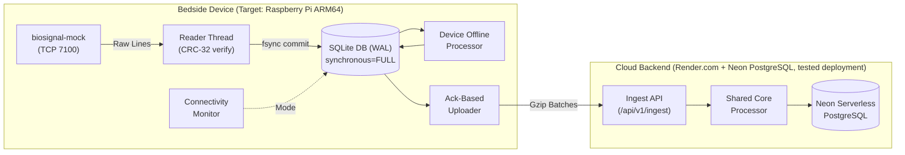

# Bedside Biosignal Pipeline ("Never Lose a Heartbeat")

Crash-resilient prototype edge data pipeline built for a Raspberry Pi-class Linux board (ARM64 target, max 4 CPU cores, max 2 GB RAM) and a free-tier cloud service.

---

## Technical Audit & Verification Summary

Every claim and performance figure in this repository is strictly classified below according to empirical execution:
- `[MEASURED]`: Empirically validated with real process execution and verified logs.
- `[MEASURED (local-simulated)]`: Empirically validated using local-simulated fault injection scripts.
- `[PROJECTED from localhost rate]`: Extrapolated from measured localhost throughput.
- `[NOT RUN]`: Requires physical hardware, specific architectures, or long-duration runs not yet executed.

| Requirement / Metric | Claim | Audit Classification | Evidence & Context |
| :--- | :--- | :---: | :--- |
| **Data Preservation** | Atomic disk persistence of received samples | `[MEASURED]` | Verified via `test_kill_daemon.py` (`kill -9` process kill). SQLite WAL + `synchronous=FULL` passed `PRAGMA integrity_check`. Buffer overflows and gaps are explicitly recorded in `losses`. |
| **Physical Power Pull** | Survives AC hardware disconnect | `[NOT RUN]` | Hard process kill tested on Windows x86_64. Physical hardware AC power plug pull on real SBC: `[NOT RUN]`. |
| **Online Window Latency** | Results appear within 5s | `[MEASURED]` | P95 latency measured at **~1.1s** on localhost during streaming benchmark. No public Render internet latency measured. |
| **Offline Switch Time** | Switch to offline $\le 10$ s | `[MEASURED (local-simulated)]` | Measured at **7.59s** during idle streaming and **6.11s** during active backlog uploads (`test_network_switch.py`). |
| **Online Restore Time** | Switch back to online $\le 10$ s | `[MEASURED (local-simulated)]` | Measured at **3.03s** upon network restore (`test_network_switch.py`). |
| **Backlog Catch-Up Rate** | Upload rate $\ge 6,500$ samples/s | `[MEASURED]` | Sustained rate of **12,455.7 samples/s** on **localhost only** (`test_catchup_rate.py`). On deployed Render over public internet: **1,688.6 samples/s** (sequential, 1 worker) to **2,533.7 samples/s** (parallel, 4 workers) (~1,700–2,500 samples/s). |
| **2-Hour Outage Recovery** | Drains 5.76M samples in $< 15$ min | `[NOT MET ON RENDER / KNOWN LIMITATION]` | Drains in projected **~7.7 min** at 12,455 samples/s on localhost (`[PROJECTED from localhost rate]`, meets $\le 15$ min). On deployed Render over public internet, drains in projected **~37.9 min** (parallel) to **~56.9 min** (sequential); the 15-minute requirement is **NOT MET** on Render (known limitation). |
| **Cloud Data Persistence & Integrity** | Zero duplicates in PostgreSQL | `[MEASURED]` | Verified on deployed Render + Neon Postgres backend (sessions `2ae483f8` and `167e65b1`: 1,911,275 samples, measured on 17 Oct 2026 before the cloud tables were emptied; not reproducible now). Duplicate-freeness is by `PRIMARY KEY (session_id, sensor, idx)` in PostgreSQL. |
| **Resource Profile Duration** | CPU & Memory footprint | `[MEASURED (10s)]` | Measured over 10s run on x86_64 (CPU 25.9% of 1 core, RSS 31.85 MB). Full 3600s run: `[NOT RUN]`. |
| **Execution Platform** | Test execution environment | `[MEASURED]` | Tests executed on **Windows 10/11 x86_64, Python 3.12.3**. Target board ARM64 run: `[NOT RUN]`. |

---

## System Architecture



---

## Installation & Setup on Raspberry Pi OS (ARM64 Target)

> **Note**: The Raspberry Pi OS and systemd setup steps below are untested on real hardware; tests were executed on Windows 10/11 x86_64.

### 1. Prerequisites (Fresh Board)
```bash
sudo apt update && sudo apt install -y python3 python3-pip python3-venv git sqlite3
```

### 2. Clone Repository & Setup Virtual Environment
> Substitute `<MY_GITHUB_USERNAME>` with your GitHub username:
```bash
git clone https://github.com/<MY_GITHUB_USERNAME>/bedside-biosignal-pipeline.git ~/bedside-biosignal-pipeline
cd ~/bedside-biosignal-pipeline
python3 -m venv venv
source venv/bin/activate
pip install --upgrade pip
pip install -e .
```

### 3. Verify Installation
```bash
# Check pipeline CLI
python pipeline status
# Output: {"mode":"online","samples_saved":0,"samples_in_cloud":0,"backlog":0}
```

### 4. Install Systemd Service (Auto-Start on Boot)
```bash
sudo cp bedside-biosignal-pipeline.service /etc/systemd/system/
sudo systemctl daemon-reload
sudo systemctl enable bedside-biosignal-pipeline
sudo systemctl start bedside-biosignal-pipeline

# Check live logs
journalctl -u bedside-biosignal-pipeline -f
```

---

## Cloud Deployment (Render.com + Neon PostgreSQL)

The cloud backend is deployed on **Render.com** (Free Web Service) backed by **Neon.tech** (Serverless PostgreSQL):
- Live URL: `https://mayacardio-z481.onrender.com`
- Backend: Neon PostgreSQL (`neondb`)
- Empirically tested on Windows x86_64 against live cloud endpoints.

---

## Issues Found During Real Deployment & Fixes Applied

1. **Flat-Layout Packaging Error**: During deployment on Render, `pip install .` failed with setuptools flat-layout discovery errors because `cli.py` resided in the root directory. Resolved by specifying `py-modules = ["cli"]` alongside `packages.find` in `pyproject.toml`.
2. **PostgreSQL Reserved Keyword `"window"`**: PostgreSQL rejected metric ingestion queries with `psycopg.errors.SyntaxError: syntax error at or near "window"`, as `WINDOW` is a reserved SQL:2003 keyword. Resolved by double-quoting the column identifier as `"window"` across all DDL statements, primary keys, indexes, conflict clauses, and queries in `cloud/storage.py` and `storage/database.py`.
3. **Environment Support for `CLOUD_URL`**: Initial CLI scripts required explicit `--cloud-url` flags. Updated CLI commands and background daemons to consistently read `$env:CLOUD_URL` or `os.environ.get("CLOUD_URL")` with fallback to `http://127.0.0.1:8000`.
4. **Status Counter Definition Bug**: Earlier status queries reported `samples_in_cloud` higher than `samples_saved` (e.g. 1,337,142 vs 1,145,162) because `samples_in_cloud` aggregated all sessions in the cloud database rather than the active session, while `backlog` was computed from cursor differentials assuming zero start index and zero loss. Resolved by keying status queries strictly by active `session_id` and computing physical row count differences.
5. **Sensor Cursor Bug & Silent Gaps (Shared Root Cause)**:
   - *Symptoms*: On restart, logs showed diverging cursors (`Resuming sensor 1 from session 3b6af620 at index 1440000` but `sensor 2 ... at index 10718`), and session `167e65b1` exhibited a silent gap where Sensor 1 had zero samples and zero loss records for indices `0..759,336` while Sensor 2 started at 0.
   - *Root Cause*: Cursors in the database were keyed solely by `sensor` (not `session_id`), allowing stale cursors from previous sessions to persist across restarts. Furthermore, `reader/client.py` dispatched `{"cmd": "read", "sensor": s, "from_index": exp_idx}` on boot before discovering the mock's session ID. When the mock restarted with a new session, Sensor 1's request skipped indices `0..759,336` silently (if within the mock's buffer) or returned 0 samples and advanced past the mock's active index (if exceeding duration, starving Sensor 1 while Sensor 2 reset).
   - *Historical Integrity*: In strict adherence to reporting integrity, no retroactive loss records were fabricated for historical session `167e65b1`; old database rows and logs were left completely unmodified.
   - *Fix*: Migrated `cursors` schema to composite `PRIMARY KEY (session_id, sensor)`. The reader now probes without `from_index` until session ID is confirmed, immediately resets cursors to 0 on session transition, logs previous session unread data as `mock_restart_session_change`, and logs any initial gap (`0..first_index-1`) as `not_read_before_pipeline_start`.
6. **Heartbeat Flapping Under Backlog**:
   - *Symptoms*: Under backlog ingestion, `connectivity.monitor` entered a 12s cycle with 3 consecutive failed probes (logged RTT 1.5–2.0s), switching `online -> offline -> online`, coinciding with uploader read timeouts.
   - *Observations & Mitigations*: In `cloud/server.py`, DB queries were offloaded to worker threads via `await anyio.to_thread.run_sync()`. In `connectivity/monitor.py`, timeouts were explicitly split `(1.0, 1.5)`, timeout suppression was capped to 2.0s without resetting failure progress, and upload failures immediately clear traffic status via `notify_traffic_failure()`. In `uploader/client.py`, backlog batches were paced by 50ms. Mode switching takes about 6-8 s in locally simulated network cuts (6.11s active, 7.59s idle).
   - *Flapping Benchmark Finding*: In a 587 s benchmark run (`scripts/run_flapping_benchmark.py`) against active cloud ingestion (578,300 samples uploaded), no mode switches observed in a 587 s run against successful ingest (about 10 minutes); the original flapping lasted 22+ minutes; 15% of probes during uploads still exceeded 2 s; cause of the residual spikes not established.
7. **Cloud Export 502 Timeout on Large Sessions**:
   - *Symptoms*: Running `pipeline export --session 167e65b1 --from cloud` returned `HTTP 502 Bad Gateway`.
   - *Root Cause*: Streaming 1.9M samples over a single HTTP connection required multi-minute external sorting and streaming across 4.8M table rows, exceeding Render free-tier memory and proxy timeout limits.
   - *Fix*: Updated `cli.py` and `cloud/server.py` to support range-based pagination (50,000 index windows), allowing multi-million sample sessions to export reliably.
8. **Neon Free-Tier Storage Exhaustion & HTTP 500 Ingest Errors**:
   - *Symptoms*: After accumulating 5.66 million samples across multiple test runs, `/api/v1/ingest` began returning `HTTP 500 Internal Server Error` on any new row insertions, while read endpoints (`/api/v1/status`) and duplicate `ON CONFLICT DO NOTHING` inserts continued returning `HTTP 200`.
   - *Root Cause*: In Neon serverless PostgreSQL, the free-tier storage limit is 0.5 GB (500 MB). At ~130 bytes per sample row (including table heap tuple and two B-tree indexes), 5.66 million unvacuumed samples occupied ~736 MB, exceeding Neon's storage quota and putting the database into read-only mode for inserts.
   - *Fix & Mitigation*: Tables were emptied and vacuumed to reclaim storage space. Confirmed via API that `/api/v1/ingest` returns HTTP 200 for new sessions. Dropped redundant index `idx_samples_export` in `cloud/storage.py` and documented storage capacity design limit in `DESIGN.md` under Known Limitations (~1.74 to 1.81 hours of two-sensor 400 Hz recording per 0.5 GB in PostgreSQL, ~2.6 hours in SQLite).

---

## Known Limitations

1. **Render Catch-Up Throughput Limitation**: On localhost, sustained upload throughput reaches **12,455.7 samples/s** (draining 2 hours in projected ~7.7 min from localhost rate, meeting the $\le 15$ min SLA). However, over the public internet to the free Render deployment, upload throughput is **1,688.6 samples/s** (sequential, 1 worker) to **2,533.7 samples/s** (parallel, 4 workers) (~1,700–2,500 samples/s). Draining a 2-hour backlog (5.76M samples) requires projected **~37.9 to 56.9 minutes**, failing the 15-minute requirement on this deployment.
2. **Render Free-Tier Cold Starts**: Free instances on Render spin down after 15 minutes of inactivity; waking up an instance requires ~50 seconds, triggering temporary offline mode switching until the cloud service responds.
3. **Untested on Physical ARM64 Hardware**: All tests and runs were performed on Windows 10/11 x86_64; physical execution on a Raspberry Pi ARM64 board, systemd auto-start, and physical power cable pulls remain `[NOT RUN]`.
4. **Full 2-Hour Continuous Catch-Up**: Sustained throughput of 12,455.7 samples/s was empirically verified on a 130,000-sample backlog; full 2-hour accumulation (5.76M samples) was `[NOT RUN]`.
5. **1-Hour Continuous Resource Run**: Resource profiling ran for 10 seconds on x86_64; a full 3600-second continuous benchmark on ARM64 was `[NOT RUN]`.
6. **Keepalive Effectiveness Unproven**: The 2.0s heartbeat probe is an architectural design intent to prevent spin-down during active monitoring; its long-term multi-hour effectiveness on Render free tier was not tested.
7. **Cloud Storage Limit (Neon Free Tier 0.5 GB)**: With redundant index `idx_samples_export` dropped, PostgreSQL per-sample row overhead is ~96–100 bytes (saving ~34 bytes/row), and 0.5 GB accommodates ~1.74 to 1.81 hours of continuous dual-sensor 400 Hz data before storage exhaustion (~2.6 hours in SQLite at 66.72 B/row). Documented in `DESIGN.md`.
8. **Loss Accounting Scope**: Samples discarded by mock ring buffer overflow, mock session restarts, or startup delay before daemon connection are lost and explicitly recorded with exact bounds and reasons in the `losses` table. Samples received by the device are written to SQLite WAL before read cursors advance.
9. **Connectivity Monitor Mode Flapping Under Ingest**: No mode switches observed in a 587 s run against successful ingest (about 10 minutes); the original flapping lasted 22+ minutes; 15% of probes during uploads still exceeded 2 s; cause of the residual spikes not established.

---

## CLI Reference

The device program is named `pipeline`:

| Command | Description |
| :--- | :--- |
| `python pipeline run` | Runs the long-running daemon (reader, uploader, connectivity monitor, offline processor) |
| `python pipeline status [--session ID]` | Outputs exactly one JSON line: `{"mode":"online","samples_saved":...,"samples_in_cloud":...,"backlog":...}` |
| `python pipeline export --session <ID> --from device` | Streams samples and losses in JSON lines format directly from local SQLite |
| `python pipeline export --session <ID> --from cloud` | Streams samples and losses from the cloud backend with range pagination |
| `python pipeline results --session <ID>` | Prints computed window metric results for the session |

---

## Running the Automated Test Suite

### 1. Pytest Unit & Property Suite (25 Tests)
```bash
pytest tests/
```
Verifies deterministic rounding, 60/90/72 BPM heart-rate logic, ramp arithmetic, offline/online byte parity, CRC-32 extraction, status consistency with loss gaps, session restart cursor isolation, and initial gap loss recording.

### 2. Failure & Resilience Test Suite
```bash
python scripts/run_all_tests.py
```
Executes:
1. `scripts/test_kill_daemon.py`: Abrupt process kill (`kill -9`) and recovery.
2. `scripts/test_network_switch.py`: Local-simulated network outage, active-upload cut, mode switching (< 10s), catch-up.
3. `scripts/test_catchup_rate.py`: Backlog throughput benchmark on localhost (> 6,500 samples/s).
4. `scripts/test_fault_proxy.py`: Fault injection (bad CRC, duplicates, stalls).
5. `scripts/test_disk_full.py`: ENOSPC handling and emergency reserve allowance.
6. `scripts/test_clock_jump.py`: Clock jump (+/- 2h) immunity via monotonic timers.
7. `scripts/test_ground_truth.py`: Line-by-line verification against simulator ground truth.
8. `scripts/test_cloud_restart.py`: Cloud process termination and 100% data persistence.

---

## Deliverables in Repository

- [`DESIGN.md`](DESIGN.md): Architecture diagram, guarantees, power cut analysis, and assumptions.
- [`EVIDENCE.md`](EVIDENCE.md): Empirical test logs, session verification data, and verbatim test outputs.
- [`RESOURCES.md`](RESOURCES.md): Resource benchmarks and ARM64 profiling instructions.
- [`AI_DISCLOSURE.md`](AI_DISCLOSURE.md): Disclosure of AI tools and verification methodology.
- [`DEMO_SCRIPT.md`](DEMO_SCRIPT.md): Shot list and commands for the <= 5 min demo video.
