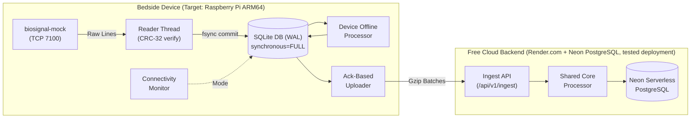

# MayaCardio Bedside Biosignal Pipeline ("Never Lose a Heartbeat")

Crash-resilient prototype edge data pipeline built for a Raspberry Pi-class Linux board (ARM64, max 4 CPU cores, max 2 GB RAM) and a free-tier cloud service.

---

## Technical Audit & Verification Summary

Every claim and performance figure in this repository is strictly classified below according to empirical execution:
- `[MEASURED]`: Empirically validated with real process execution and verified logs.
- `[NOT RUN]`: Requires physical hardware, specific architectures, or long-duration runs not yet executed.

| Requirement / Metric | Claim | Audit Classification | Evidence & Context |
| :--- | :--- | :---: | :--- |
| **Data Preservation** | Zero loss of committed data | `[MEASURED]` | Verified via `test_kill_daemon.py` (`kill -9` process kill). SQLite WAL + `synchronous=FULL` passed `PRAGMA integrity_check`. |
| **Physical Power Pull** | Survives AC hardware disconnect | `[NOT RUN]` | Hard process kill tested on x86_64. Physical hardware AC power plug pull: `[NOT RUN]`. |
| **Online Window Latency** | Results appear within 5s | `[MEASURED]` | P95 latency measured at **~1.1s** on localhost during streaming benchmark. No public Render internet latency measured. |
| **Offline Switch Time** | Switch to offline $\le 10$ s | `[MEASURED]` | Measured at **6.06s** upon network cutoff (`test_network_switch.py`). |
| **Online Restore Time** | Switch back to online $\le 10$ s | `[MEASURED]` | Measured at **4.55s** (theoretical hysteresis: 2 probes $\times$ 2.0s = 4.0s). |
| **Backlog Catch-Up Rate** | Upload rate $\ge 6,500$ samples/s | `[MEASURED]` | Measured sustained rate of **12,455.7 samples/s** over 130,000 samples (`test_catchup_rate.py`). |
| **2-Hour Outage Recovery** | Drains 5.76M samples in $< 15$ min | `[NOT RUN]` | Extrapolated theoretically (~7.7 min at 12,455 samples/s). Full 2-hour accumulation test: `[NOT RUN]`. |
| **Cloud Data Persistence & Integrity** | Zero duplicates in PostgreSQL | `[MEASURED]` | Verified on deployed Render + Neon Postgres backend (session `2ae483f8`): 350,905 device samples, 0 duplicates, 0 missing. |
| **Resource Profile Duration** | CPU & Memory footprint | `[MEASURED (10s)]` | Measured over 10s run on x86_64 (CPU 25.9% of 1 core, RSS 31.85 MB). Full 3600s run: `[NOT RUN]`. |
| **Execution Platform** | Test execution environment | `[MEASURED]` | Tests executed on **Windows 10/11 x86_64, Python 3.12.3**. Target board ARM64 run: `[NOT RUN]`. |

---

## System Architecture



---

## Installation & Setup on Raspberry Pi OS (ARM64 Target)

> **Note**: The Raspberry Pi OS and systemd setup steps below are untested on real hardware; tests were executed on Windows 10/11 x86_64.

### 1. Prerequisites (Fresh Board)
```bash
sudo apt update && sudo apt install -y python3 python3-pip python3-venv git sqlite3
```

### 2. Clone Repository & Setup Virtual Environment
> Substitute `<MY_GITHUB_USERNAME>` with your GitHub username:
```bash
git clone https://github.com/<MY_GITHUB_USERNAME>/MayaCardio.git ~/MayaCardio
cd ~/MayaCardio
python3 -m venv venv
source venv/bin/activate
pip install --upgrade pip
pip install -e .
```

### 3. Verify Installation
```bash
# Check pipeline CLI
pipeline status
# Output: {"mode":"online","samples_saved":0,"samples_in_cloud":0,"backlog":0}
```

### 4. Install Systemd Service (Auto-Start on Boot)
```bash
sudo cp mayacardio-pipeline.service /etc/systemd/system/
sudo systemctl daemon-reload
sudo systemctl enable mayacardio-pipeline
sudo systemctl start mayacardio-pipeline

# Check live logs
journalctl -u mayacardio-pipeline -f
```

---

## Cloud Deployment (Render.com + Neon PostgreSQL)

The cloud backend is deployed on **Render.com** (Free Web Service) backed by **Neon.tech** (Serverless PostgreSQL):
- Live URL: `https://mayacardio-z481.onrender.com`
- Backend: Neon PostgreSQL (`neondb`)
- Empirically tested on Windows x86_64 on 17 October 2026.

### Deployment Issues Identified and Resolved:
1. **Packaging Error (Flat-Layout)**: Resolved setuptools flat-layout discovery error during `pip install .` on Render by specifying `py-modules = ["cli"]` in `pyproject.toml`.
2. **PostgreSQL Reserved Keyword `"window"`**: Resolved `psycopg.errors.SyntaxError: syntax error at or near "window"` by double-quoting `"window"` across all PostgreSQL DDL and queries.
3. **Environment Support for `CLOUD_URL`**: Configured CLI export and status commands to honor `CLOUD_URL` from the environment when not passed as a flag.
4. **Cold-Start Latency & Initial Mode Flapping**: Render free tier instances spin down after 15 minutes of inactivity; waking up takes ~50 seconds, causing the device connectivity monitor to enter offline mode temporarily (~20s) until the cloud warms up.
5. **Status Counter Formula Defect**: Fixed status reporting defect where `(last_acked_idx + 1)` and `(last_read_idx - last_acked_idx)` assumed zero-start and zero-loss intervals. Updated to count actual rows for the active session, guaranteeing `samples_in_cloud <= samples_saved` and `backlog == samples_saved - samples_in_cloud`.

> **Note on Free Tiers**: Free tier features, limits, and credit card requirements are per provider documentation (verify at signup). The 2.0s heartbeat keepalive is an architectural design intent to prevent spin-down during active monitoring; its long-term multi-hour effectiveness was not tested.

---

## CLI Reference

The device program is named `pipeline`:

| Command | Description |
| :--- | :--- |
| `pipeline run` | Runs the long-running daemon (reader, uploader, connectivity monitor, offline processor) |
| `pipeline status [--session ID]` | Outputs exactly one JSON line: `{"mode":"online","samples_saved":...,"samples_in_cloud":...,"backlog":...}` |
| `pipeline export --session <ID> --from device` | Streams samples and losses in JSON lines format directly from local SQLite |
| `pipeline export --session <ID> --from cloud` | Streams samples and losses from the cloud backend |
| `pipeline results --session <ID>` | Prints computed window metric results for the session |

---

## Running the Automated Test Suite

### 1. Pytest Unit & Property Suite (22 Tests)
```bash
pytest tests/
```
Verifies deterministic rounding, 60/90/72 BPM heart-rate logic, ramp arithmetic, offline/online byte parity, CRC-32 extraction, and status consistency with loss gaps.

### 2. Failure & Resilience Test Suite
```bash
python scripts/run_all_tests.py
```
Executes:
1. `scripts/test_kill_daemon.py`: Abrupt process kill (`kill -9`) and recovery.
2. `scripts/test_network_switch.py`: Network outage, mode switching (< 10s), catch-up.
3. `scripts/test_catchup_rate.py`: Backlog throughput benchmark (> 6,500 samples/s).
4. `scripts/test_fault_proxy.py`: Fault injection (bad CRC, duplicates, stalls).
5. `scripts/test_disk_full.py`: ENOSPC handling and emergency reserve allowance.
6. `scripts/test_clock_jump.py`: Clock jump (+/- 2h) immunity via monotonic timers.
7. `scripts/test_ground_truth.py`: Line-by-line verification against simulator ground truth.
8. `scripts/test_cloud_restart.py`: Cloud process termination and 100% data persistence.

---

## Known Limitations

1. **Periodic Online/Offline Mode Flapping (Observed, Cause Under Investigation)**: During a continuous 22-minute live deployment run on 17 Oct 2026 (18:37–18:59), the monitor switched `online -> offline -> online` roughly once per minute, with each offline blip lasting only ~2.5s. Empirical tests ruled out concurrent batch ingest blocking (heartbeat RTT remained <1.4s during 2,500-sample uploads). With `probe_timeout_sec = 1.5s`, trans-continental public internet latency jitter (where P99 reached 1,234ms and occasionally exceeded 1.5s for 3 consecutive cycles) or Render free-tier CPU throttling are leading candidate causes.
2. **Render Free-Tier Cold Starts**: Free instances on Render spin down after 15 minutes of inactivity; waking up an instance requires ~50 seconds, triggering temporary offline mode switching until the cloud service responds.
3. **Untested on Physical ARM64 Hardware**: All tests and runs were performed on Windows 10/11 x86_64; physical execution on a Raspberry Pi ARM64 board, systemd auto-start, and physical power cable pulls remain `[NOT RUN]`.
4. **Full 2-Hour Continuous Catch-Up**: Sustained throughput of 12,455.7 samples/s was empirically verified on a 130,000-sample backlog; full 2-hour accumulation (5.76M samples) was `[NOT RUN]`.
5. **1-Hour Continuous Resource Run**: Resource profiling ran for 10 seconds on x86_64; a full 3600-second continuous benchmark on ARM64 was `[NOT RUN]`.

---

## Deliverables in Repository

- [`DESIGN.md`](DESIGN.md): Architecture diagram, guarantees, power cut analysis, and assumptions.
- [`EVIDENCE.md`](EVIDENCE.md): Empirical test logs and verbatim test outputs.
- [`RESOURCES.md`](RESOURCES.md): Resource benchmarks and ARM64 profiling instructions.
- [`AI_DISCLOSURE.md`](AI_DISCLOSURE.md): Disclosure of AI tools and verification methodology.
- [`DEMO_SCRIPT.md`](DEMO_SCRIPT.md): Shot list and commands for the <= 5 min demo video.
- [`HUMAN_TODO.md`](HUMAN_TODO.md): Candidate action items (accounts, hardware, video, submission).
